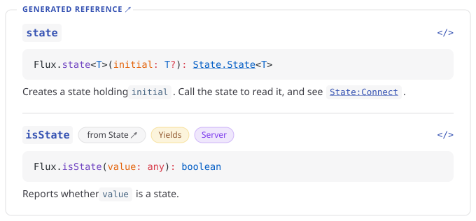

<div align="right">
<a href="https://luaudocs.kohl.gg"></a>
<a href="https://luaudocs.kohl.gg"><picture><source media="(prefers-color-scheme: dark)" srcset=".github/img/link-docs-dark.svg"></picture></a>
<a href="https://luaudocs.kohl.gg/api/"><picture><source media="(prefers-color-scheme: dark)" srcset=".github/img/link-api-dark.svg"></picture></a>
<a href="https://www.npmjs.com/package/luaudocs"><picture><source media="(prefers-color-scheme: dark)" srcset=".github/img/link-npm-dark.svg"></picture></a>
</div>
<br/>
<br/>
<br/>
<br/>

<div align="center">

# No tags. Real types. One command.

_LuauDocs generates [VitePress](https://vitepress.dev) documentation sites from your Luau source code. It evaluates what your modules return, reads your type annotations and doc comments directly, and links every type to its definition._

[](https://github.com/kohltastrophe/luaudocs/actions/workflows/ci.yml) [](https://app.codecov.io/gh/kohltastrophe/luaudocs) [](LICENSE.md) [](https://www.npmjs.com/package/luaudocs)

---

<picture><source media="(prefers-color-scheme: dark)" srcset=".github/img/h3-notags-dark.svg"></picture>

<div align="left">

```luau
local State = require("@self/State")
local Util = require("@self/Util")

--[[ A tiny reactive state library. ]]
local Flux = {}

Flux.State = State
Flux.Util = Util

--[[ Reports whether `value` is a state. ]]
Flux.isState = State.isState

--[[
Creates a state holding `initial`.

Call the state to read it, and see [State:Connect] for reacting to changes.
]]
function Flux.state<T>(initial: T?): State.State<T>
	return State.new(initial)
end

return Flux
```

LuauDocs parses your module and symbolically evaluates its top-level `return` statement. Everything reachable from that return value becomes your public API reference, while local helpers and `_`-prefixed members stay private automatically.

</div>

---

<picture><source media="(prefers-color-scheme: dark)" srcset=".github/img/h3-types-dark.svg"></picture>

<a href="https://luaudocs.kohl.gg/api/Flux"><picture><source media="(prefers-color-scheme: dark)" srcset=".github/img/entry-card-dark.svg"></picture></a>

</div>

Signatures come straight from your Luau annotations, so you never duplicate parameter or return types in `@param` and `@return` tags. Referenced types link to their declarations, `[State:Connect]` resolves to its method entry, and behavioral badges like `Yields` and `Server` are inferred from your code.

---

<div align="center">

<picture><source media="(prefers-color-scheme: dark)" srcset=".github/img/h3-command-dark.svg"></picture>

<div align="left">

```markdown
## Flux

- [Flux](examples/Flux/init.luau): A tiny reactive state library.
- [`Flux.State: State`](examples/Flux/State.luau): [Module]
- [`Flux.state<T>(initial: T?): State.State<T>`](examples/Flux/init.luau#L18-L20): Creates a state holding `initial`.
- [`Flux.isState(value: any): boolean`](examples/Flux/State.luau#L20-L22): [from State] Reports whether `value` is a state.
```

Run `luaudocs dev` to preview a searchable VitePress site with live reload, or `luaudocs llms` to write a compact `llms.txt` index linking every guide and public symbol to its `file:line` declaration. Need custom tooling? Run `luaudocs build --model` to export your full API as JSON.

</div>
</div>

---

## Batteries Included

LuauDocs handles the full documentation workflow out of the box:

- **Symbolic Discovery:** Evaluates your module's [`return` value](https://luaudocs.kohl.gg/guide/how-it-works) to find public functions, classes, properties, and re-exports without doc tags.
- **Automatic Badges:** Infers [`Yields`, `Server`, `Client`, `Plugin`, and `Read Only`](https://luaudocs.kohl.gg/guide/overriding-with-tags#adding-badges) badges directly from function bodies, `RunService` guards, and `table.freeze`.
- **Linked Signatures:** Reads [types from your annotations](https://luaudocs.kohl.gg/guide/how-it-works#types-get-their-own-entries) and links project types, [cross-site dependencies](https://luaudocs.kohl.gg/guide/configuration#source-aliases), and Roblox datatypes.
- **Access-Path Navigation:** Organizes the [API sidebar and breadcrumbs](https://luaudocs.kohl.gg/guide/how-it-works#access-paths-not-folders) around the expression callers write (`Flux.Util.Queue`) rather than folder paths.
- **Moonwave Compatible:** Supports all [24 Moonwave tags](https://luaudocs.kohl.gg/guide/reference/tags) as overrides and [migrates your existing config, guides, and static assets](https://luaudocs.kohl.gg/guide/migrating-from-moonwave) in one command.
- **Coding Agents & JSON Model:** Generates [`llms.txt` indexes](https://luaudocs.kohl.gg/guide/coding-agents) with `file:line` source links and exports your full API as a [JSON doc model](https://luaudocs.kohl.gg/guide/reference/doc-model).
- **Rich Guides & Embeds:** Write guides with [tabs, admonitions, inline highlighting, and `<Frame>` embeds](https://luaudocs.kohl.gg/guide/reference/markup) that pull live entries from your generated API pages.

## Quick Start

Requires [Node.js](https://nodejs.org/en/download) 22.12 or newer. LuauDocs automatically downloads, verifies, and caches a pinned [Lute](https://github.com/luau-lang/lute) binary on first run.

```bash
npm i -g luaudocs
cd my-luau-library
luaudocs dev
```

Already using [Moonwave](https://github.com/evaera/moonwave)? Run `luaudocs init --from-moonwave` before `dev` to convert your project in place.

Read the **[Getting Started](https://luaudocs.kohl.gg/guide/getting-started)** guide or browse the **[Example API](https://luaudocs.kohl.gg/api/)** generated from [`examples/Flux`](https://github.com/kohltastrophe/luaudocs/tree/main/examples/Flux).

## Sponsors

LuauDocs is free and MIT-licensed. If LuauDocs is useful to you or your team, you can support its development through [GitHub Sponsors](https://github.com/sponsors/kohltastrophe) or [Ko-fi](https://ko-fi.com/kohltastrophe).

<p align="center">
  <a href="https://github.com/sponsors/kohltastrophe"></a>&nbsp;&nbsp;<a href="https://ko-fi.com/kohltastrophe"></a>
  <a href="https://github.com/sponsors/kohltastrophe"></a>
</p>

## License

LuauDocs is released under the [MIT License](LICENSE.md).
